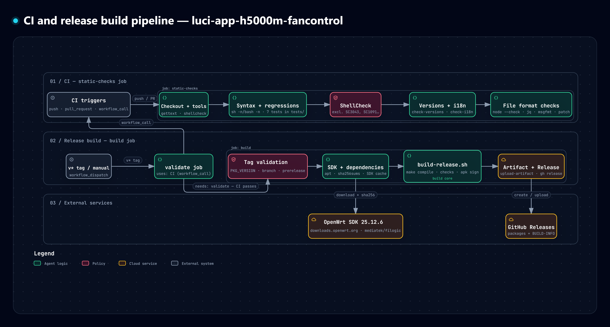

# Releasing H5000M Fan Control

us **English** | [🇷🇺 Русский](#ru) | [🇨🇳 简体中文](#zh) | [🇩🇪 Deutsch](#de)

*The English text is canonical.*

## Release model

| Branch | Tags | Published as |
|---|---|---|
| `beta` | `vX.Y.Z-beta.N` | GitHub **prerelease** (`beta` in the name, not "Latest") |
| `main` | `vX.Y.Z` | regular GitHub Release, marked "Latest" |

GitHub Actions enforces three rules on every tag push:

1. The tag's base version must equal `PKG_VERSION` in the Makefile of the tagged commit (`v2.4.0-beta.1` → `2.4.0`).
2. A `-beta.*` tag commit must be contained in the `beta` branch history; a stable tag commit must be contained in `main` (`git merge-base --is-ancestor`).
3. Tags with a `-beta.` suffix automatically get `--prerelease`; a pre-release never becomes "Latest".

`scripts/release.sh` repeats the same checks locally *before* creating the tag (plus a clean tree, `HEAD == origin/<branch>` and no duplicate tag), so a wrong release fails in seconds instead of a red CI run. Tags pushed by hand without the script are still rejected by CI.

## Pipeline overview



Every push, pull request and `workflow_call` runs the `static-checks` job
(syntax + regression tests, ShellCheck, version/i18n sync, file format
checks). A `v*` tag or a manual run additionally triggers the `build` job,
which reuses the CI job via `workflow_call`, validates the tag (Makefile
version, branch ancestry, prerelease flag), builds the packages with the
OpenWrt SDK and publishes the artifacts to GitHub Releases. See
`.github/workflows/ci.yml` and `.github/workflows/release.yml`. A push to
the default branch additionally runs the `sdk-cache` job, which downloads the
OpenWrt SDK archive into the Actions cache: tag builds restore it from there
instead of re-downloading it on every release (GitHub does not share caches
between tags).

## Cutting a beta release

1. On `beta`, bump the Makefile to the new version: `PKG_VERSION:=2.4.0`, `PKG_RELEASE:=1`. Commit and push.
2. Make sure the working tree is clean and in sync with `origin/beta`.
3. Publish the beta:

   ```sh
   bash scripts/release.sh v2.4.0-beta.1
   ```

   The script creates an annotated tag and pushes it; Actions builds the SDK packages and publishes "H5000M Fan Control v2.4.0-beta.1" with `.apk`/`.ipk` assets, SHA256SUMS and the build key.
4. Fix bugs found in beta, push to `beta`, then cut the next iteration:

   ```sh
   bash scripts/release.sh v2.4.0-beta.2
   ```

   Do **not** bump `PKG_VERSION` between `-beta.N` iterations — the tag base must keep matching it.

## Cutting a stable release

1. When a `-beta.N` is good enough, merge `beta` into `main` (via PR).
2. On `main`: pull, clean tree, then:

   ```sh
   bash scripts/release.sh v2.4.0
   ```

   A regular release is published and becomes "Latest"; beta prereleases stay available.
3. Start the next cycle: bump `PKG_VERSION` on `beta` (e.g. `2.5.0`).

## Hotfix releases (2.4.0 → 2.4.1)

1. Commit the fix on `main` with `PKG_VERSION:=2.4.1`, push.
2. `bash scripts/release.sh v2.4.1`.
3. Merge `main` back into `beta` — otherwise `beta`'s Makefile keeps an older base version and the next `v2.4.1-beta.N` tag will fail validation.

## Notes

- OpenWrt package versions never contain the `-beta` suffix (a beta of 2.4.0 still ships as `2.4.0-r1`); the prerelease is identified by the git tag and the GitHub release name.
- If a build for an existing tag failed, just re-run the job: the publish step falls back to `gh release upload --clobber` and does not create a duplicate.
- A wrong tag that already triggered a run: delete it and the release, then cut the next `-beta.N`:

  ```sh
  git push origin :refs/tags/v2.4.0-beta.1
  git tag -d v2.4.0-beta.1
  gh release delete v2.4.0-beta.1 --cleanup-tag
  ```

- A manual workflow run (`workflow_dispatch`) skips validation and publishing: it only produces build artifacts — useful for testing the SDK build.
- CI requires the top `## X.Y.Z` heading of `CHANGELOG.md` (the English block at the top of the merged changelog) to equal `PKG_VERSION` in the Makefile: update the changelog in the same commit that bumps the version.
- On Windows run `scripts/release.sh` from Git Bash or WSL; the script already tolerates CRLF checkouts of the Makefile.

<a id="ru"></a>

<details>
<summary><b>🇷🇺 Русский</b></summary>

# Выпуск релизов H5000M Fan Control

## Модель релизов

| Ветка | Теги | Публикуется как |
|---|---|---|
| `beta` | `vX.Y.Z-beta.N` | **пре-релиз** GitHub (`beta` в названии, не "Latest") |
| `main` | `vX.Y.Z` | обычный релиз GitHub, статус "Latest" |

GitHub Actions при каждом пуше тега проверяет три правила:

1. Base-версия тега должна равняться `PKG_VERSION` в Makefile помеченного коммита (`v2.4.0-beta.1` → `2.4.0`).
2. Коммит `-beta.*`-тега должен входить в историю ветки `beta`, стабильного тега — в `main` (`git merge-base --is-ancestor`).
3. Теги с суффиксом `-beta.` автоматически получают `--prerelease`; пре-релиз никогда не становится "Latest".

`scripts/release.sh` повторяет те же проверки локально *до* создания тега (плюс чистое дерево, `HEAD == origin/<ветка>` и отсутствие дубля) — неверный релиз отсеивается за секунды, а не красным CI. Теги, запушенные вручную без скрипта, по-прежнему отклоняются CI.

## Обзор пайплайна


Каждый push, pull request и `workflow_call` запускают job `static-checks`
(синтаксис + регрессионные тесты, ShellCheck, сверка версий и переводов,
проверки форматов файлов). Тег `v*` или ручной запуск дополнительно поднимают
job `build`: он переиспользует CI через `workflow_call`, валидирует тег
(версия Makefile, принадлежность ветке, флаг prerelease), собирает пакеты в
OpenWrt SDK и публикует артефакты в GitHub Releases. См.
`.github/workflows/ci.yml` и `.github/workflows/release.yml`. Push в ветку
по умолчанию дополнительно запускает job `sdk-cache`, который кладёт архив
OpenWrt SDK в кэш Actions: сборки тегов восстанавливают его оттуда и не
качают заново на каждый релиз (GitHub не делится кэшем между тегами).

## Выпуск беты

1. В `beta` поднимите версию в Makefile: `PKG_VERSION:=2.4.0`, `PKG_RELEASE:=1`. Коммит и push.
2. Убедитесь, что дерево чистое и синхронизировано с `origin/beta`.
3. Выпустите бету:

   ```sh
   bash scripts/release.sh v2.4.0-beta.1
   ```

   Скрипт создаст аннотированный тег и запушит его; Actions соберёт пакеты в SDK и опубликует «H5000M Fan Control v2.4.0-beta.1» с ассетами `.apk`/`.ipk`, SHA256SUMS и ключом сборки.
4. После фиксов бага в бете — push в `beta` и следующая итерация:

   ```sh
   bash scripts/release.sh v2.4.0-beta.2
   ```

   `PKG_VERSION` между `-beta.N` **не меняется** — base тега должен продолжать ему соответствовать.

## Выпуск стабильной версии

1. Когда `-beta.N` достаточен — смержите `beta` в `main` (через PR).
2. В `main`: pull, чистое дерево, затем:

   ```sh
   bash scripts/release.sh v2.4.0
   ```

   Публикуется обычный релиз со статусом "Latest"; беты остаются доступными.
3. Начните новый цикл: поднимите `PKG_VERSION` в `beta` (например, `2.5.0`).

## Хотфиксы (2.4.0 → 2.4.1)

1. Фикс в `main` с `PKG_VERSION:=2.4.1`, push.
2. `bash scripts/release.sh v2.4.1`.
3. Подтяните `main` обратно в `beta` — иначе в Makefile ветки `beta` останется старая base-версия, и следующий тег `v2.4.1-beta.N` не пройдёт валидацию.

## Примечания

- Версии пакетов OpenWrt не содержат суффикс `-beta` (бета 2.4.0 поставляется как `2.4.0-r1`); пре-релиз опознаётся по git-тегу и названию релиза GitHub.
- Если сборка существующего тега упала — просто перезапустите job: шаг публикации использует `gh release upload --clobber` и не создаст дубликат.
- Неверный тег уже запушен? Удалите тег и релиз, затем выпустите следующую `-beta.N`:

  ```sh
  git push origin :refs/tags/v2.4.0-beta.1
  git tag -d v2.4.0-beta.1
  gh release delete v2.4.0-beta.1 --cleanup-tag
  ```

- Ручной запуск workflow (`workflow_dispatch`) пропускает валидацию и публикацию: собираются только артефакты — удобно для теста SDK-сборки.
- CI требует, чтобы верхний заголовок `## X.Y.Z` `CHANGELOG.md` (английский блок в начале объединённого файла) совпадал с `PKG_VERSION` в Makefile: обновляйте чейнджлог в том же коммите, что и подъём версии.
- На Windows запускайте `scripts/release.sh` из Git Bash или WSL; скрипт учитывает CRLF-рабочее дерево Makefile.

</details>

<a id="zh"></a>

<details>
<summary><b>🇨🇳 简体中文</b></summary>

# H5000M Fan Control 发布指南

## 发布模型

| 分支 | 标签 | 发布形式 |
|---|---|---|
| `beta` | `vX.Y.Z-beta.N` | GitHub **预发布版本**（名称含 `beta`，不会成为 "Latest"） |
| `main` | `vX.Y.Z` | 普通 GitHub Release，标记为 "Latest" |

每次推送标签时，GitHub Actions 强制校验三条规则：

1. 标签的 base 版本必须等于被标记提交中 Makefile 的 `PKG_VERSION`（`v2.4.0-beta.1` → `2.4.0`）。
2. `-beta.*` 标签的提交必须包含在 `beta` 分支历史中，稳定标签的提交必须包含在 `main` 中（`git merge-base --is-ancestor`）。
3. 带 `-beta.` 后缀的标签自动获得 `--prerelease`；预发布版本永远不会成为 "Latest"。

`scripts/release.sh` 在创建标签*之前*于本地重复同样的检查（外加工作区干净、`HEAD == origin/<分支>`、标签不重复），错误发布几秒内即被拦截，而不是留下一条红色 CI 记录。绕过脚本手动推送的标签仍会被 CI 拒绝。

## 流水线概览


每次 push、pull request 与 `workflow_call` 都会运行 `static-checks` 任务
（语法与回归测试、ShellCheck、版本与翻译同步、文件格式检查）。`v*` 标签或
手动运行会额外触发 `build` 任务：它通过 `workflow_call` 复用 CI，校验标签
（Makefile 版本、分支归属、预发布标志），用 OpenWrt SDK 构建软件包，并将
产物发布到 GitHub Releases。见 `.github/workflows/ci.yml` 与
`.github/workflows/release.yml`。推送到默认分支还会额外运行
`sdk-cache` 任务，将 OpenWrt SDK 归档存入 Actions 缓存：标签构建直接
从缓存恢复，无需每次发布都重新下载（GitHub 不会在标签之间共享缓存）。

## 发布测试版

1. 在 `beta` 上提升 Makefile 版本：`PKG_VERSION:=2.4.0`、`PKG_RELEASE:=1`，提交并推送。
2. 确保工作区干净并与 `origin/beta` 同步。
3. 发布测试版：

   ```sh
   bash scripts/release.sh v2.4.0-beta.1
   ```

   脚本创建附注标签并推送；Actions 在 SDK 中构建软件包并发布 "H5000M Fan Control v2.4.0-beta.1"，附带 `.apk`/`.ipk`、SHA256SUMS 和构建公钥。
4. 修复 beta 中发现的问题后推送到 `beta`，再发布下一个迭代：

   ```sh
   bash scripts/release.sh v2.4.0-beta.2
   ```

   `-beta.N` 迭代之间**不要**修改 `PKG_VERSION` —— 标签 base 必须始终与它一致。

## 发布稳定版

1. 某个 `-beta.N` 足够稳定后，将 `beta` 合并到 `main`（通过 PR）。
2. 在 `main` 上：pull、工作区干净，然后：

   ```sh
   bash scripts/release.sh v2.4.0
   ```

   发布普通版本并获得 "Latest"；测试版仍保留。
3. 开始下一个周期：在 `beta` 上提升 `PKG_VERSION`（如 `2.5.0`）。

## 热修复（2.4.0 → 2.4.1）

1. 在 `main` 提交修复并设置 `PKG_VERSION:=2.4.1`，推送。
2. `bash scripts/release.sh v2.4.1`。
3. 将 `main` 重新合并回 `beta` —— 否则 `beta` 的 Makefile 仍是旧的 base 版本，下一个 `v2.4.1-beta.N` 标签将无法通过校验。

## 备注

- OpenWrt 软件包版本不含 `-beta` 后缀（2.4.0 的测试版仍为 `2.4.0-r1`）；预发布通过 git 标签和 GitHub 发布名称区分。
- 已有标签构建失败时，直接重新运行 job 即可：发布步骤使用 `gh release upload --clobber`，不会产生重复发布。
- 误推标签？删除标签和发布，然后发布下一个 `-beta.N`：

  ```sh
  git push origin :refs/tags/v2.4.0-beta.1
  git tag -d v2.4.0-beta.1
  gh release delete v2.4.0-beta.1 --cleanup-tag
  ```

- 手动运行 workflow（`workflow_dispatch`）跳过校验与发布，只产出构建工件 —— 适合测试 SDK 构建。
- CI 要求 `CHANGELOG.md`（合并文件顶部的英文块）顶部的 `## X.Y.Z` 标题与 Makefile 中的 `PKG_VERSION` 一致：请在提升版本的同一提交中更新变更日志。
- Windows 下请在 Git Bash 或 WSL 中运行 `scripts/release.sh`；脚本已兼容 Makefile 的 CRLF 工作副本。

</details>

<a id="de"></a>

<details>
<summary><b>🇩🇪 Deutsch</b></summary>

# Freigabe von H5000M Fan Control

## Release-Modell

| Branch | Tags | Veröffentlicht als |
|---|---|---|
| `beta` | `vX.Y.Z-beta.N` | GitHub-**Prerelease** (`beta` im Namen, nicht „Latest") |
| `main` | `vX.Y.Z` | reguläres GitHub-Release, als „Latest" markiert |

GitHub Actions erzwingt bei jedem Tag-Push drei Regeln:

1. Die Basisversion des Tags muss `PKG_VERSION` im Makefile des getaggten Commits entsprechen (`v2.4.0-beta.1` → `2.4.0`).
2. Der Commit eines `-beta.*`-Tags muss in der Historie des Branches `beta` enthalten sein, der eines stabilen Tags in `main` (`git merge-base --is-ancestor`).
3. Tags mit dem Suffix `-beta.` erhalten automatisch `--prerelease`; ein Prerelease wird niemals „Latest".

`scripts/release.sh` wiederholt dieselben Prüfungen lokal *vor* dem Erstellen des Tags (plus sauberer Arbeitsbaum, `HEAD == origin/<branch>` und kein doppelter Tag), sodass ein fehlerhaftes Release in Sekunden scheitert statt als roter CI-Lauf. Von Hand ohne Skript gepushte Tags lehnt die CI weiterhin ab.

## Pipeline-Übersicht


Jeder Push, Pull Request und `workflow_call` läuft als Job `static-checks`
(Syntax + Regressionstests, ShellCheck, Versions-/Übersetzungsabgleich,
Dateiformatprüfungen). Ein `v*`-Tag oder ein manueller Lauf löst zusätzlich den
Job `build` aus, der die CI über `workflow_call` wiederverwendet, den Tag
validiert (Makefile-Version, Branch-Abstammung, Prerelease-Flag), mit dem
OpenWrt-SDK baut und die Artefakte zu GitHub Releases veröffentlicht. Siehe
`.github/workflows/ci.yml` und `.github/workflows/release.yml`. Ein Push in
den Standard-Branch startet zusätzlich den Job `sdk-cache`, der das
OpenWrt-SDK-Archiv in den Actions-Cache legt: Tag-Builds stellen es daraus
wieder her und laden es nicht bei jedem Release erneut (GitHub teilt Caches
nicht zwischen Tags).

## Eine Beta veröffentlichen

1. Im Branch `beta` die Makefile-Version anheben: `PKG_VERSION:=2.4.0`, `PKG_RELEASE:=1`. Committen und pushen.
2. Sicherstellen, dass der Arbeitsbaum sauber und mit `origin/beta` synchron ist.
3. Die Beta veröffentlichen:

   ```sh
   bash scripts/release.sh v2.4.0-beta.1
   ```

   Das Skript erstellt einen annotierten Tag und pusht ihn; Actions baut die SDK-Pakete und veröffentlicht „H5000M Fan Control v2.4.0-beta.1" mit `.apk`-/.ipk`-Assets, SHA256SUMS und dem Build-Schlüssel.
4. Gefundene Fehler in der Beta beheben, nach `beta` pushen, dann die nächste Iteration schneiden:

   ```sh
   bash scripts/release.sh v2.4.0-beta.2
   ```

   `PKG_VERSION` zwischen `-beta.N`-Iterationen **nicht** ändern — die Tag-Basis muss weiterhin übereinstimmen.

## Ein stabiles Release veröffentlichen

1. Wenn eine `-beta.N` gut genug ist: `beta` in `main` mergen (per PR).
2. Auf `main`: pull, sauberer Arbeitsbaum, dann:

   ```sh
   bash scripts/release.sh v2.4.0
   ```

   Ein reguläres Release wird veröffentlicht und wird zu „Latest"; Beta-Prereleases bleiben verfügbar.
3. Den nächsten Zyklus beginnen: `PKG_VERSION` auf `beta` anheben (z. B. `2.5.0`).

## Hotfix-Releases (2.4.0 → 2.4.1)

1. Den Fix auf `main` mit `PKG_VERSION:=2.4.1` committen, pushen.
2. `bash scripts/release.sh v2.4.1`.
3. `main` zurück in `beta` mergen — sonst behält der Makefile von `beta` eine ältere Basisversion, und der nächste Tag `v2.4.1-beta.N` schlägt die Validierung fehl.

## Hinweise

- OpenWrt-Paketversionen enthalten niemals das Suffix `-beta` (eine Beta von 2.4.0 liefert weiterhin als `2.4.0-r1`); der Prerelease wird über den Git-Tag und den GitHub-Release-Namen identifiziert.
- Schlägt ein Build für einen bestehenden Tag fehl, den Job einfach erneut ausführen: Der Veröffentlichungsschritt greift auf `gh release upload --clobber` zurück und erzeugt kein Duplikat.
- Ein falscher Tag, der bereits einen Lauf ausgelöst hat: Tag und Release löschen, dann die nächste `-beta.N` schneiden:

  ```sh
  git push origin :refs/tags/v2.4.0-beta.1
  git tag -d v2.4.0-beta.1
  gh release delete v2.4.0-beta.1 --cleanup-tag
  ```

- Ein manueller Workflow-Lauf (`workflow_dispatch`) überspringt Validierung und Veröffentlichung: Er erzeugt nur Build-Artefakte — nützlich zum Testen der SDK-Builds.
- Die CI verlangt, dass die oberste `## X.Y.Z`-Überschrift des `CHANGELOG.md` (der englische Block oben in der zusammengeführten Datei) `PKG_VERSION` im Makefile entspricht: Aktualisieren Sie das Änderungsprotokoll im selben Commit wie die Versionsanhebung.
- Unter Windows `scripts/release.sh` aus Git Bash oder WSL ausführen; das Skript toleriert CRLF-Auschecken des Makefiles.

</details>
